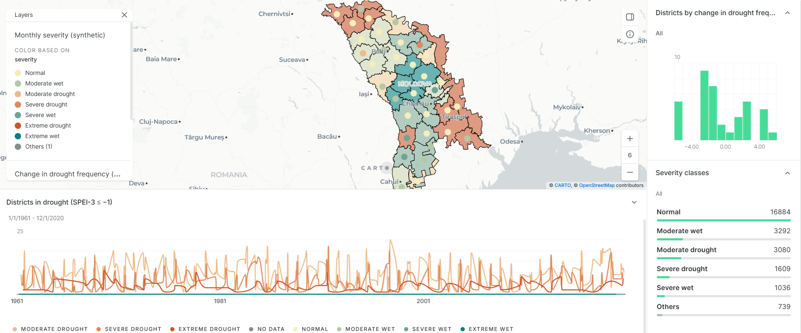
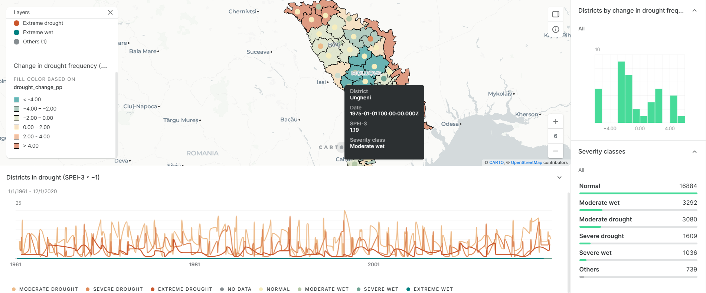
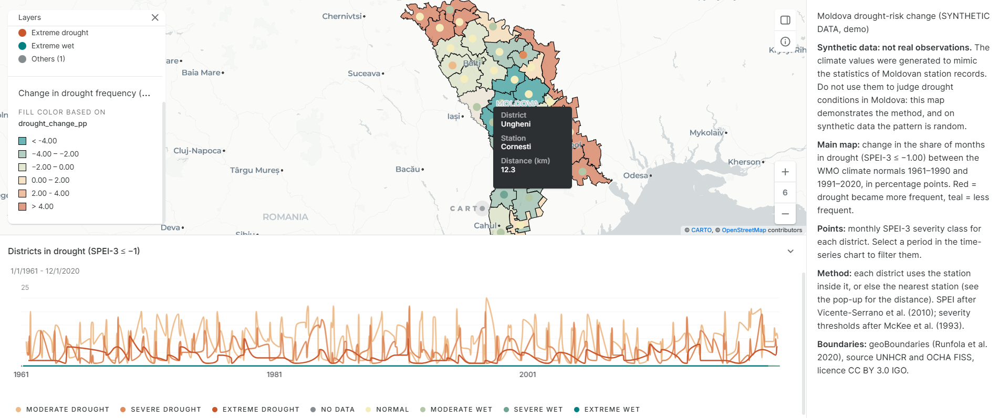

# Moldova Drought Risk

A data pipeline that turns monthly station SPEI values into district-level drought severity and drought-risk change for Moldova, exported as GeoParquet tables for a CARTO Builder dashboard.

> **Synthetic data: not real observations.**
> The climate values in this project were generated to mimic the statistics of Moldovan station records. They are not measurements and must not be used to judge actual drought conditions in Moldova. The project demonstrates the pipeline, not the climate.

## What it does

1. Loads monthly SPEI-3 for 16 station locations (1961–2020).
2. Classifies each month into seven severity categories.
3. Gives each of Moldova's 37 first-level districts one station's series.
4. Measures how drought frequency changed between the WMO climate normals 1961–1990 and 1991–2020.
5. Exports two GeoParquet tables ready to load into CARTO.

## Severity classes

SPEI-3 is classified into seven categories. A value exactly on a threshold belongs to the more extreme category.

| SPEI-3 | Category | Code |
|---|---|---|
| SPEI ≥ 2.00 | Extreme wet | 3 |
| 1.50 ≤ SPEI < 2.00 | Severe wet | 2 |
| 1.00 ≤ SPEI < 1.50 | Moderate wet | 1 |
| −1.00 < SPEI < 1.00 | Normal | 0 |
| −1.50 < SPEI ≤ −1.00 | Moderate drought | −1 |
| −2.00 < SPEI ≤ −1.50 | Severe drought | −2 |
| SPEI ≤ −2.00 | Extreme drought | −3 |
| missing | No data | (empty) |

Each station's first two months have no SPEI-3 (a 3-month window needs 3 months of data) and are classed as "No data".

References:
- SPEI: Vicente-Serrano, S.M., Beguería, S. & López-Moreno, J.I. (2010). A multiscalar drought index sensitive to global warming: the Standardized Precipitation Evapotranspiration Index. *Journal of Climate* 23(7), 1696–1718.
- Category thresholds: McKee, T.B., Doesken, N.J. & Kleist, J. (1993). The relationship of drought frequency and duration to time scales. *8th Conference on Applied Climatology*, Anaheim, CA, 179–184.

## From stations to districts

Each of the 37 districts takes the monthly SPEI-3 series of one station:

- If a station lies inside the district, that station is used (13 districts). If several do, the one closest to the district's interior point wins.
- Otherwise the nearest station is used (24 districts).
- Distances run from a point guaranteed to lie inside the district, computed in MOLDREF99 / Moldova TM (EPSG:4026), and are reported as `distance_km`.

Every row records its `station`, whether that station lies inside the district (`station_inside`) and `distance_km`, so the dashboard can show where each value comes from.

## Drought-risk metric

A month is "in drought" when it is Moderate drought or worse (SPEI-3 ≤ −1.00). For each district the pipeline reports the share of months in drought in the two WMO 30-year climate normals, 1961–1990 and 1991–2020, and the change between them in percentage points (`drought_change_pp`).

Why the change rather than the overall share: SPEI is standardised against each station's own 1961–2020 record, so over that full period every station spends about 16% of months at or below −1.00 by construction (17.5–20.1% here). Comparing two sub-periods shows whether drought became more or less frequent.

## Outputs

`python -m moldova_drought` writes two GeoParquet files (EPSG:4326) to `data/processed/`:

| File | Rows | Geometry | Columns |
|---|---|---|---|
| `synthetic_district_drought_risk.parquet` | 37 | district polygons | `district_id`, `district`, `station`, `station_inside`, `distance_km`, `drought_pct_1961_1990`, `drought_pct_1991_2020`, `drought_change_pp`, `driest_spei_3`, `driest_month` |
| `synthetic_district_monthly_spei.parquet` | 26,640 | one point per district | `district_id`, `district`, `date`, `spei_3`, `severity`, `severity_code` |

The monthly table places each district at a point inside it instead of repeating its polygon for all 720 months. Join it to the risk table on `district_id` when polygons are needed.

## Dashboard

**Live map:** [Moldova drought-risk change (SYNTHETIC DATA, demo)](https://pinea.app.carto.com/map/e9fbaa6e-0855-4e3d-bd75-610b5b8bb5aa) on CARTO.

Both tables are loaded into CARTO Builder following the click-by-click guide in [docs/carto.md](docs/carto.md): a diverging map of the change in drought frequency, monthly severity points filtered by a time-series chart, a severity-class widget, a histogram of the change, and pop-ups showing which station each district uses. The dashboard's figures reconcile with the pipeline output (for example, 16,884 Normal district-months, and 18 districts in drought in August 1963).

Screenshots from 24 October 2026. The live map runs on a CARTO trial workspace and may stop working when the trial ends; these show what it contains.



*Overview: change in drought frequency between 1961–1990 and 1991–2020 (red = more frequent, teal = less), with monthly severity points, the number of districts in drought over time, and the severity-class counts.*



*Monthly point pop-up and the risk-layer legend with breaks at −4, −2, 0, 2 and 4.*



*The map description carries the synthetic-data warning, the method and the boundary attribution; a district pop-up shows which station it uses and how far away it is.*

## Limitations

- The climate data is synthetic (see the top of this page). On synthetic data the change in drought frequency is random noise: the map shows that the method works, not a real trend.
- 24 of 37 districts have no station of their own and borrow the nearest one, up to 43 km away.
- Transnistria is one long, narrow district: a single station (Tiraspol) represents all of it, although Rabnita, also inside it, is 93 km from its interior point.
- Station values are not averaged: the mean of several SPEI series is not itself a standardised SPEI and pulls values towards Normal.

## Status

Trial 1 is complete: the pipeline (scaffold, inputs, loading and validation, classification, stations to districts, risk summary and export) and the published CARTO dashboard.

## Quick start (Windows, PowerShell)

```powershell
py -3.14 -m venv .venv
.\.venv\Scripts\Activate.ps1
pip install -r requirements.txt
pip install -e . --no-deps
python -m moldova_drought
pytest
```

`requirements.txt` pins the exact versions the project was tested with. `pip install -e .` then installs this package in editable mode, without re-resolving those versions. `python -m moldova_drought` downloads the boundaries (once) and runs the whole pipeline.

## Data

| Dataset | File | Source | Licence |
|---|---|---|---|
| Station SPEI (synthetic) | `data/raw/synthetic_station_spei.csv` (committed) | Generated by the author's `generate_synthetic_data.py` (seed 42) | MIT |
| District boundaries (37 ADM1 units) | `data/external/geoBoundaries-MDA-ADM1.geojson` (downloaded) | [geoBoundaries](https://www.geoboundaries.org) gbOpen, from UNHCR and OCHA FISS via HDX | CC BY 3.0 IGO |

Every input is pinned by a SHA-256 checksum in `src/moldova_drought/config.py`. Raw files are never edited; all cleaning happens in code.

Boundaries citation: Runfola, D. et al. (2020). geoBoundaries: A global database of political administrative boundaries. *PLoS ONE* 15(4): e0231866.

## Repository layout

```
├── pyproject.toml       # package metadata, dependencies, tool config
├── requirements.txt     # exact pinned versions (pip freeze)
├── docs/carto.md        # click-by-click CARTO Builder guide
├── docs/img/            # dashboard screenshots
├── src/moldova_drought/ # the pipeline package
└── tests/               # pytest suite
```

## Licence

MIT. See [LICENSE](LICENSE).